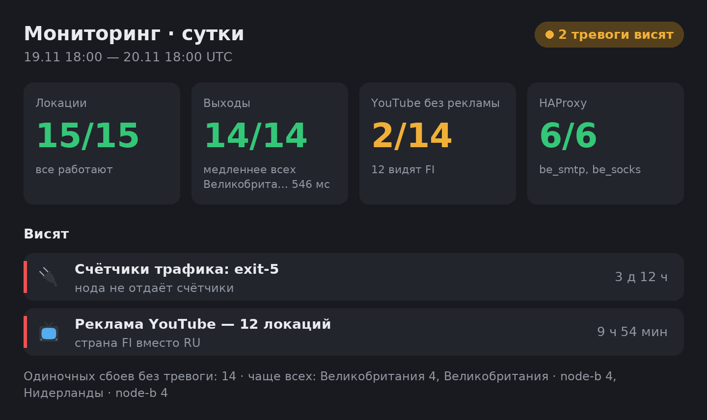
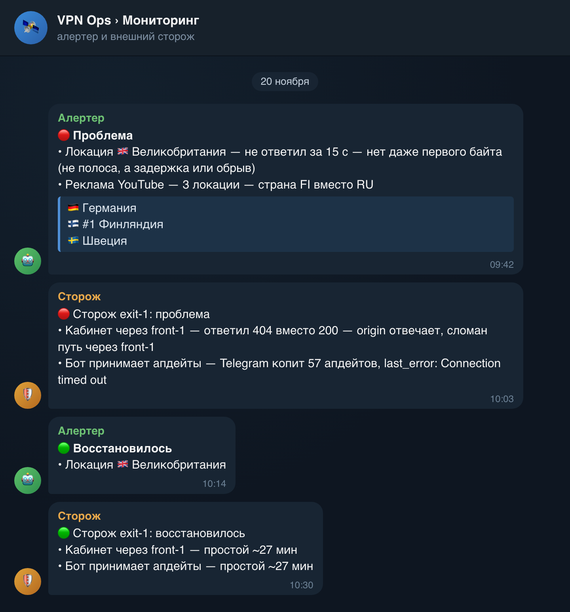
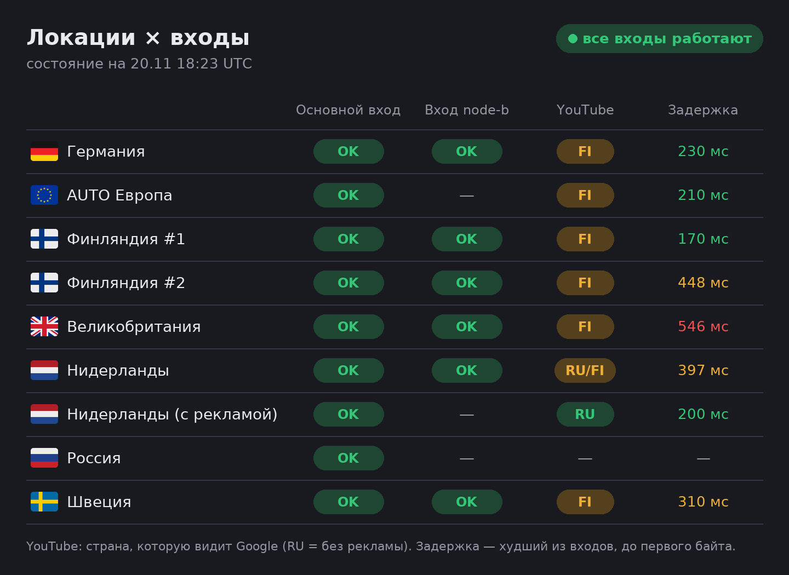
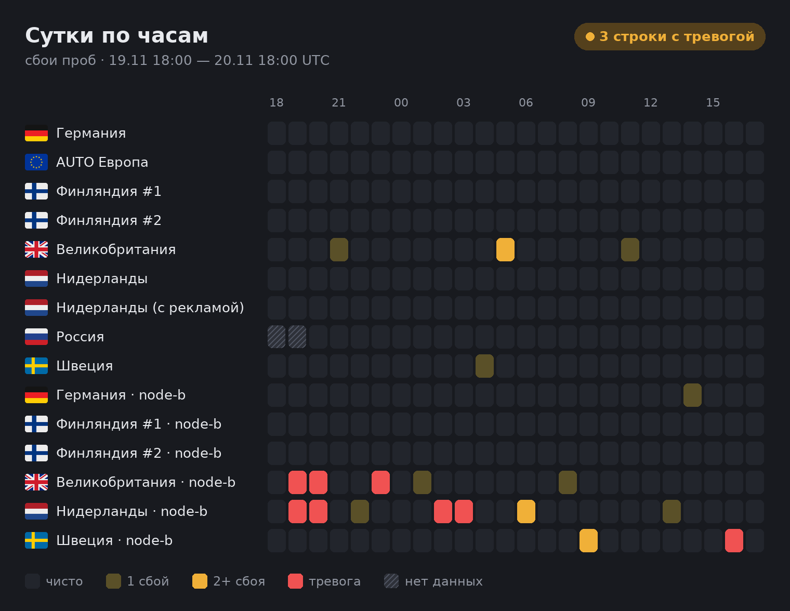
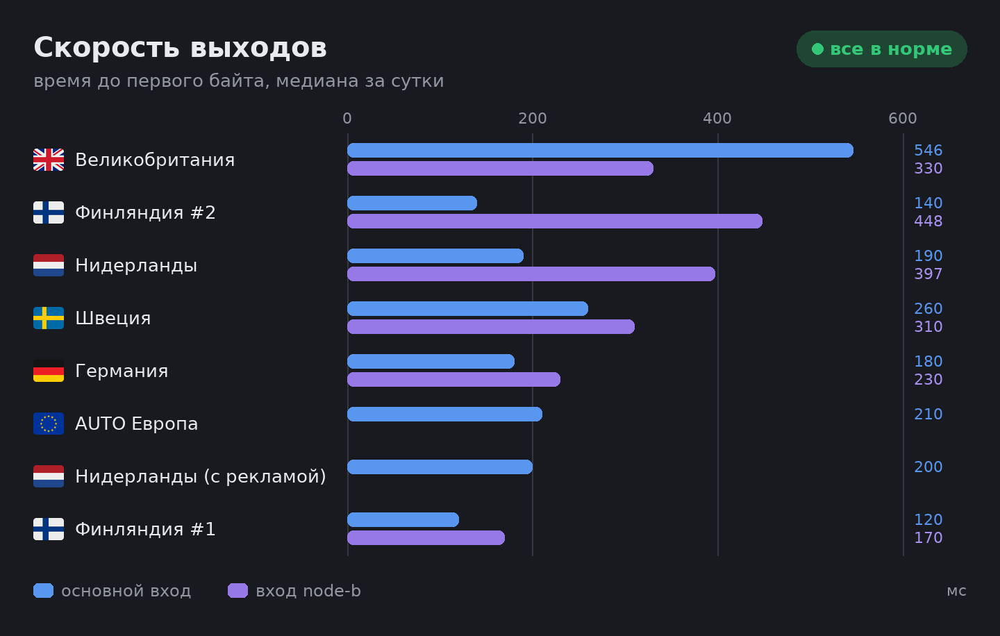
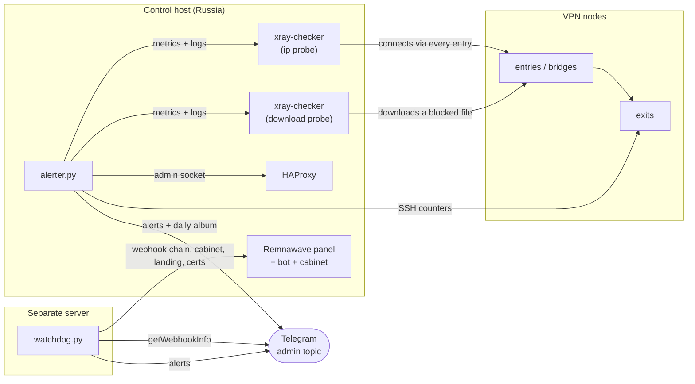

# vpn-monitoring

🇷🇺 [Читать по-русски](README.ru.md)

**Telegram alerting and daily dashboards for a VPN built on [Remnawave](https://github.com/remnawave).**
It watches what users actually feel: whether each location connects, whether exits are fast, whether YouTube
shows ads, whether the subscription link and the web cabinet open from inside Russia, and whether the bot
still receives updates. It then reports to an admin chat in plain language.

It runs in production at [ZanityVPN](https://zanityvpn.com): two small Python programs, no database and no
third-party dependencies on the servers.

<p align="center">
  
</p>

## Why

A VPN that serves users in Russia breaks in unusual ways. A server stays up while the censor (TSPU) quietly
cuts TCP to its IP. A location connects, but only the first 16 KB of a download get through. An exit's IP gets
re-geolocated and YouTube starts showing ads. The bot process is healthy, but the relay in front of its webhook
is blocked, so Telegram can't deliver updates. Ordinary uptime checks see none of this.

This project checks each of these failures directly and alerts only when they persist.

## What it watches

**Alerter** (runs next to the panel, every 2 minutes)

| Check | How |
|---|---|
| 🔌 Locations | [xray-checker](https://github.com/kutovoys/xray-checker) connects through every subscription entry; alerts with a human-readable cause: no first byte, cut bandwidth, EOF, refused |
| 🔌 Exits | a second checker downloads a file that is blocked in Russia, so a "working" exit that leaks traffic directly is caught |
| 🧯 Mass outage | if half of the locations fail at once, it sends one "mass outage" message instead of fifteen |
| 🔌 HAProxy | backends and whole pools (SOCKS pool for Telegram, SMTP tunnels) through the admin socket |
| 📊 Traffic quotas | per-node rx/tx counters over SSH against the provider's monthly limit |
| 📺 YouTube ads | every 3 h: which country YouTube sees for each location; not `RU` twice in a row means ads are back |
| 📺 YouTube speed | Russian locations: downloads 1 MB of the player script; too slow means YouTube is being throttled |
| 🎭 Masking | the selfsteal domain still points to the node, and Reality serves a certificate valid for > N days |
| 📥 Subscription via CDN | the domain resolves to the current CDN edge, the link returns 200, the certificate is fresh; also checked through each location |
| 🌐 Web | the cabinet and the landing page, checked from inside Russia (catches IP bans that a check from abroad can't see) |
| 🗓 Daily summary | an album of 4 cards and a short caption at a fixed hour; it doubles as a heartbeat, so silence means a problem, not "all green" |

**External watchdog** (on a different server, every minute)

| Check | How |
|---|---|
| 🤖 Bot receives updates | `getWebhookInfo`: Telegram is not piling up undelivered updates; plus a probe through the whole webhook relay chain to the bot |
| 🌐 Cabinet and landing | through the public path and directly on the origin, so an alert says *where* it broke ("origin answers, the relay path is broken") |
| 🔐 Certificates | cabinet and landing certificates have at least 20 days left |
| 🫀 Alerter's host | bot, panel and checker health endpoints, since the alerter goes silent together with its own server |

Every check is a sample. An alert fires after **N consecutive failures**, and recovery is reported on the first
success, together with the downtime. Related failures are glued into one line ("YouTube ads: 3 locations"),
and everything that broke in one run goes into a single message.

## How it looks

<p align="center">
  
</p>

The daily summary is a Telegram album:

| | |
|---|---|
|  |  |
| **Locations × entries**: every location through each entry point, YouTube country, latency | **24 hours by hour**: single failures, repeated failures and alerts |
|  |  |
| **Exit speed**: median time to first byte per entry | **Dashboard**: totals and alerts that are still open |

> The cards and messages are rendered from the demo fixture with made-up numbers. UI texts are in Russian
> because that is what the admin chat reads.

## Architecture



The two programs cover each other: if the control host freezes, the alerter freezes with it, but the
watchdog on another machine still reports. If that machine dies (it is also part of the webhook relay chain),
the alerter's own web checks notice.

## Try it locally

You need [uv](https://docs.astral.sh/uv/). Render the daily cards from the demo fixture, without a config or any network calls:

```bash
uv run python alerter/alerter.py --render ./preview --demo --demo-history
open preview/1_dashboard.png
```

Run the tests:

```bash
uv run pytest
```

## Repository layout

| Path | What |
|---|---|
| `alerter/alerter.py` | checks, alert state machine, Telegram delivery, CLI |
| `alerter/summary.py`, `alerter/cards.py` | daily summary: models and Pillow rendering of the 4 cards |
| `alerter/history.py`, `alerter/demo_data.py` | 24-hour history of samples; demo fixture for previews and tests |
| `watchdog/watchdog.py` | external watchdog: HTTP and certificate checks, Telegram webhook health |
| `deploy/alerter/` | example config, systemd unit, step-by-step deployment and rollback |
| `deploy/watchdog/` | example `checks.json`, systemd service and timer |
| `deploy/monitoring/` | docker-compose for the two xray-checker instances |
| `docs/OPERATIONS.md` | production notes (in Russian) |

## Running it yourself

The alerter needs only Python 3.10+, `curl` and, for the daily cards, Pillow. The watchdog uses the standard
library only. Configuration is a JSON file. `deploy/alerter/config.example.json` lists every check with a
comment explaining it, and `deploy/watchdog/checks.json` does the same for the watchdog. The alerter reads the
bot token and the admin chat ID from the bot's `.env`, so no new secrets are introduced.

This is a snapshot of a working setup, not a packaged product. It assumes Remnawave, xray-checker and a Telegram
bot, and the code comments are in Russian. Addresses, domains and host names in the examples are placeholders
(RFC 5737, `example.*`).

## License

[MIT](LICENSE)
