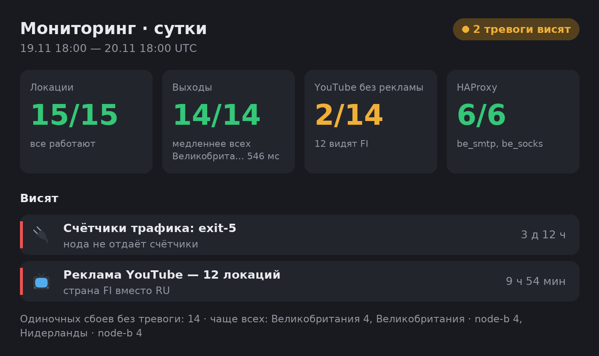
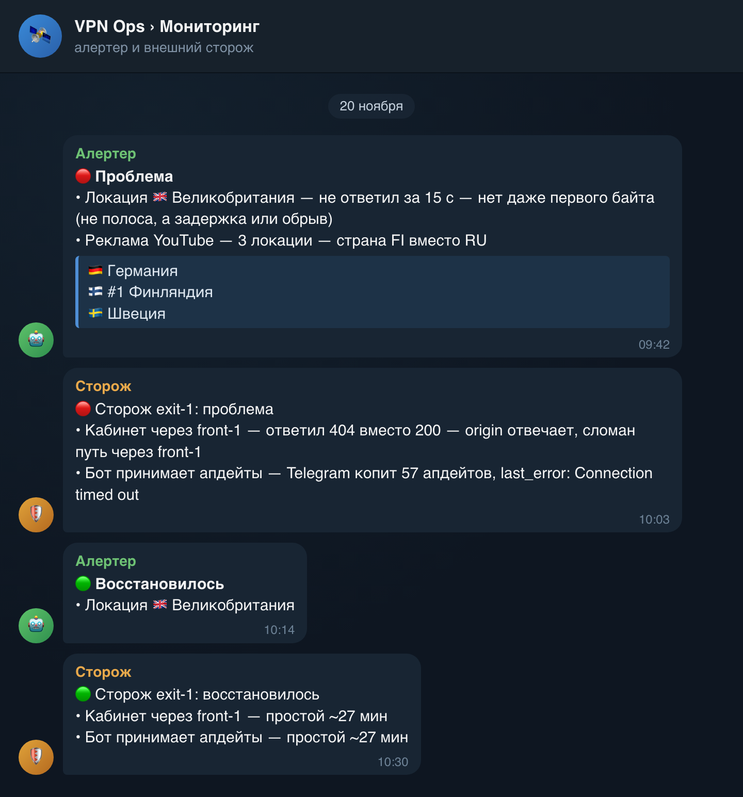
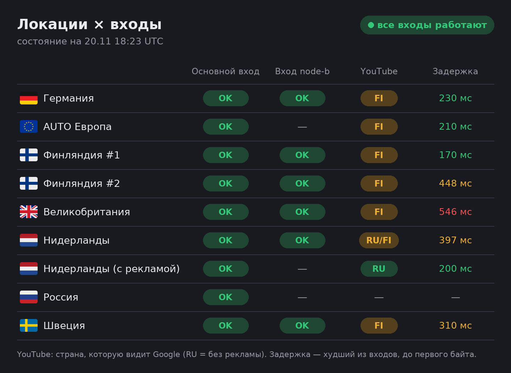
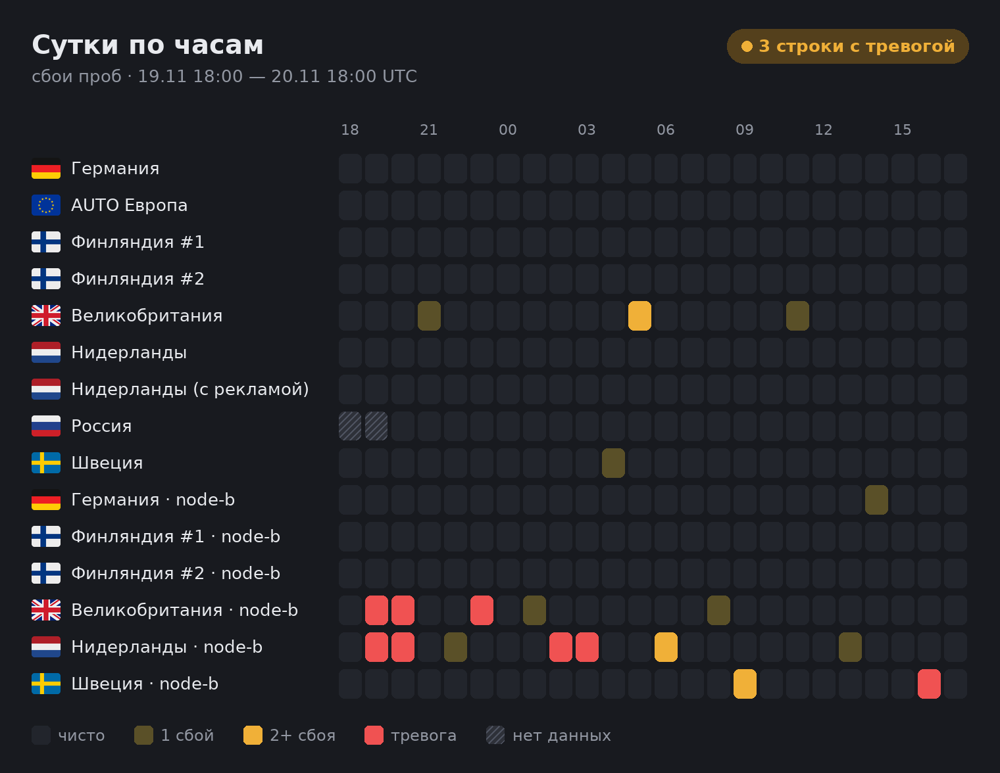
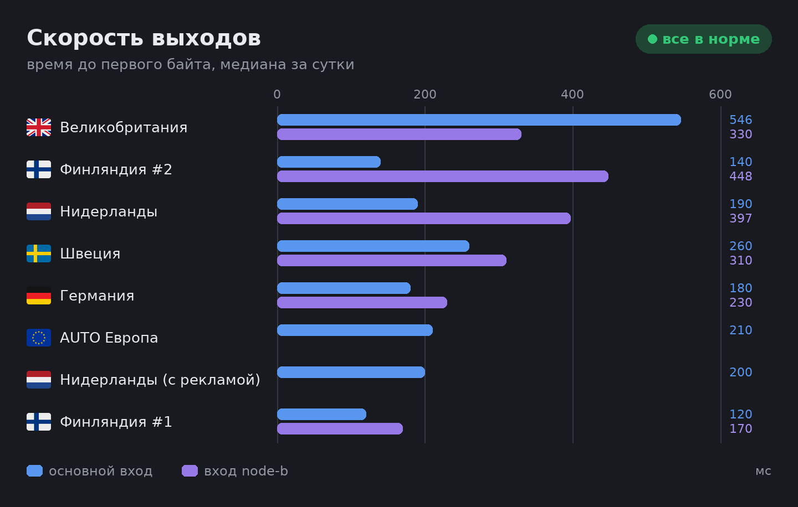
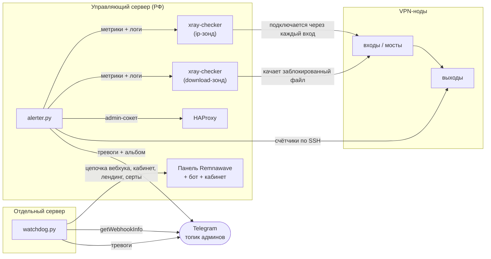

# vpn-monitoring

🇬🇧 [Read in English](README.md)

**Тревоги в Telegram и суточные сводки для VPN на [Remnawave](https://github.com/remnawave).**
Мониторинг следит за тем, что чувствуют пользователи: подключается ли каждая локация, быстрые ли выходы,
нет ли рекламы на YouTube, открываются ли из России ссылка подписки и кабинет, получает ли бот апдейты.
Обо всём этом он простым языком пишет в админ-чат.

Работает в проде [ZanityVPN](https://zanityvpn.com). Это две небольшие программы на Python, без базы данных
и без сторонних зависимостей на серверах.

<p align="center">
  
</p>

## Зачем

VPN для пользователей из России ломается необычно. Сервер жив, а ТСПУ тихо режет TCP до его IP. Локация
подключается, но из загрузки проходят только первые 16 КБ. IP выхода переезжает в другую страну в геобазе,
и на YouTube появляется реклама. Процесс бота здоров, но реле перед его вебхуком заблокировано, и Telegram
не может доставить апдейты. Обычные проверки «сервер отвечает» ничего из этого не видят.

Этот проект проверяет каждую такую поломку напрямую и шлёт тревогу, только если она держится.

## Что проверяется

**Алертер** (рядом с панелью, раз в 2 минуты)

| Проверка | Как |
|---|---|
| 🔌 Локации | [xray-checker](https://github.com/kutovoys/xray-checker) подключается через каждый вход подписки; в тревоге — причина по-человечески: нет первого байта, режут полосу, EOF, отказ |
| 🔌 Выходы | второй чекер качает файл, заблокированный в РФ, — так ловится «рабочий» выход, который на деле пускает трафик напрямую |
| 🧯 Массовый сбой | если разом легла половина локаций — одно сообщение «массовый сбой» вместо пятнадцати |
| 🔌 HAProxy | бэкенды и целые пулы (SOCKS для Telegram, SMTP-туннели) через admin-сокет |
| 📊 Квоты трафика | счётчики rx/tx нод по SSH против месячного лимита хостера |
| 📺 Реклама YouTube | раз в 3 ч: какой страной YouTube видит каждую локацию; не `RU` два раза подряд — реклама вернулась |
| 📺 Скорость YouTube | российские локации: качает 1 МБ скрипта плеера; не успел — YouTube режут |
| 🎭 Маскировка | selfsteal-домен ведёт на ноду, Reality отдаёт сертификат, которому больше N дней |
| 📥 Подписка через CDN | домен резолвится в текущий эдж CDN, ссылка отдаёт 200, сертификат свежий; плюс та же проверка через каждую локацию |
| 🌐 Веб | кабинет и лендинг — изнутри РФ (ловит бан IP, который не видно из-за границы) |
| 🗓 Суточная сводка | альбом из 4 карточек и короткая подпись в одно и то же время; заодно пульс: тишина значит проблему, а не «всё зелёное» |

**Внешний сторож** (на другом сервере, раз в минуту)

| Проверка | Как |
|---|---|
| 🤖 Бот получает апдейты | `getWebhookInfo`: Telegram не копит недоставленные апдейты; плюс запрос через всю цепочку реле вебхука до бота |
| 🌐 Кабинет и лендинг | по публичному пути и напрямую на origin, поэтому в тревоге видно, *где* сломалось («origin отвечает, сломан путь через реле») |
| 🔐 Сертификаты | у кабинета и лендинга осталось не меньше 20 дней |
| 🫀 Сервер алертера | health-эндпоинты бота, панели и чекера: алертер молчит вместе со своим сервером |

Каждая проверка — замер. Тревога — после **N неудач подряд**, восстановление — с первого успеха, вместе с
длительностью простоя. Похожие сбои склеиваются в одну строку («Реклама YouTube — 3 локации»), а всё, что
сломалось за один прогон, уходит одним сообщением.

## Как это выглядит

<p align="center">
  
</p>

Суточная сводка приходит альбомом:

| | |
|---|---|
|  |  |
| **Локации × входы**: каждая локация через каждый вход, страна YouTube, задержка | **Сутки по часам**: одиночные сбои, повторные и тревоги |
|  |  |
| **Скорость выходов**: медиана времени до первого байта по входам | **Дашборд**: итоги и тревоги, которые ещё висят |

> Карточки и сообщения отрисованы по демо-фикстуре с выдуманными числами.

## Архитектура



Программы страхуют друг друга. Если управляющий сервер завис, алертер замолкает вместе с ним, но сторож на
другой машине сообщит. Если умер сервер сторожа (он ещё и звено цепочки вебхука), это заметят web-проверки
алертера.

## Попробовать локально

Нужен [uv](https://docs.astral.sh/uv/). Отрисовать карточки сводки по демо-фикстуре, без конфига и сети:

```bash
uv run python alerter/alerter.py --render ./preview --demo --demo-history
open preview/1_dashboard.png
```

Тесты:

```bash
uv run pytest
```

## Устройство репозитория

| Путь | Что |
|---|---|
| `alerter/alerter.py` | проверки, логика тревог, отправка в Telegram, CLI |
| `alerter/summary.py`, `alerter/cards.py` | суточная сводка: модели и отрисовка 4 карточек на Pillow |
| `alerter/history.py`, `alerter/demo_data.py` | история замеров за сутки; демо-фикстура для превью и тестов |
| `watchdog/watchdog.py` | внешний сторож: HTTP и сертификаты, здоровье вебхука Telegram |
| `deploy/alerter/` | пример конфига, юнит systemd, пошаговая выкладка и откат |
| `deploy/watchdog/` | пример `checks.json`, сервис и таймер systemd |
| `deploy/monitoring/` | docker-compose для двух xray-checker |
| `docs/OPERATIONS.md` | заметки по эксплуатации прода |

## Как запустить у себя

Алертеру нужны только Python 3.10+, `curl` и, для карточек, Pillow; сторож обходится стандартной библиотекой.
Настройки — в JSON. В `deploy/alerter/config.example.json` каждая проверка описана комментарием, у сторожа то
же самое в `deploy/watchdog/checks.json`. Токен бота и ID админ-чата алертер берёт из `.env` бота, так что
новых секретов не появляется.

Это снимок работающей установки, а не готовый продукт: рассчитан на Remnawave, xray-checker и Telegram-бота.
Адреса, домены и имена хостов в примерах — заглушки (RFC 5737, `example.*`).

## Лицензия

[MIT](LICENSE)
